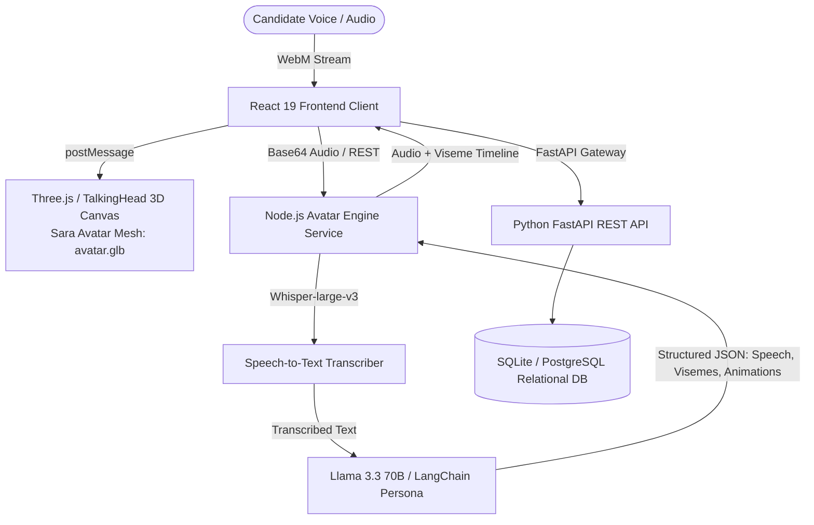

# Hired - Intelligent Recruitment Automation & Sara 3D AI Interviewer

[](https://react.dev/)
[](https://fastapi.tiangolo.com/)
[](https://nodejs.org/)
[](https://threejs.org/)
[](https://opensource.org/licenses/MIT)

> **Live Deployment:** [https://yasmenmad.github.io/hired/](https://yasmenmad.github.io/hired/)  
> **Interactive 3D Avatar:** Sara (Virtual HR Interviewer with Three.js & TalkingHead)  
> **Technical Architecture:** [`AVATAR_LOGIC.md`](./AVATAR_LOGIC.md) | [`BACKEND_ARCHITECTURE.md`](./BACKEND_ARCHITECTURE.md) | [`FRONTEND_ARCHITECTURE.md`](./FRONTEND_ARCHITECTURE.md)  
> **Author:** Yasmine Daoudi

A production-grade recruitment automation platform that integrates career management, automated resume scoring, and **Sara**, a real-time conversational 3D AI interviewer powered by phoneme-synchronized lip-sync, Whisper-large-v3 speech recognition, and Llama 3.3 70B persona modeling.

---

## System Architecture



---

## Core Engineering Modules

### 1. Sara 3D Avatar Engine (`avatar_engine` & `avatar.html`)
- **Three.js & TalkingHead:** Loads dynamic upper-body 3D mesh (`avatar.glb`) with realistic viseme morph targets for phoneme-accurate lip-synchronization.
- **Bi-Directional Communication:** Uses window `postMessage` protocol between the React parent and the sandboxed 3D WebGL context to trigger dynamic gestures (welcoming, questioning, thinking, agreeing).
- **Emotion Analysis:** Dynamically adjusts persona prompts if stress indicators are detected during interview rounds.

### 2. Frontend Client (React 19 + Tailwind CSS 4)
- **Domain-Driven Design (DDD):** Layered separation across `domain/`, `application/`, `infrastructure/`, and `presentation/`.
- **Pages & Tooling:** Live interview room (`AvatarInterviewPage.jsx`), interactive job tracking Kanban board, salary benchmarking visualizer, and candidate profile management.

### 3. Backend Services (FastAPI & Node.js)
- **FastAPI REST Engine:** Asynchronous job indexing, application tracking, and profile matching.
- **Node.js Avatar Microservice:** High-throughput streaming audio ingestion and Whisper/LangChain pipeline.

---

## Technical Specifications & Documentation

- Detailed 3D lip-sync and audio pipeline: [`AVATAR_LOGIC.md`](./AVATAR_LOGIC.md)
- Backend services & API routes: [`BACKEND_ARCHITECTURE.md`](./BACKEND_ARCHITECTURE.md)
- Frontend component architecture: [`FRONTEND_ARCHITECTURE.md`](./FRONTEND_ARCHITECTURE.md)
- Conception and business requirements: [`PROJECT_CONCEPTION.md`](./PROJECT_CONCEPTION.md)

---

## Local Development Quickstart

### 1. Frontend Development Server
```bash
cd frontend
npm install
npm run dev
```

### 2. Backend Services
```bash
# Python FastAPI
cd backend
python -m venv venv
venv\Scripts\activate  # On Linux/macOS: source venv/bin/activate
pip install -r requirements.txt
uvicorn app.main:app --reload

# Avatar Engine (Node.js)
cd backend/avatar_engine
npm install
node index.js
```

---

## License

MIT Open Source License - Copyright (c) 2026 Yasmine Daoudi
