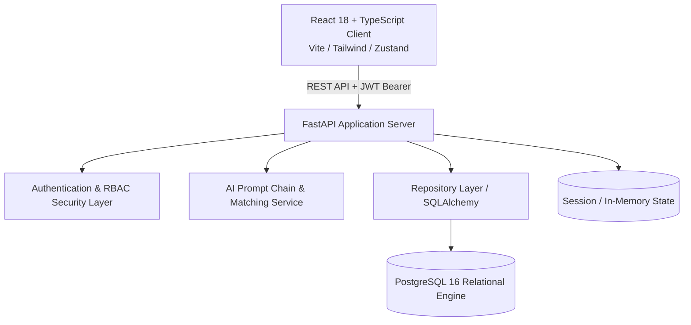

# Hired - Distributed Career Management & Application Automation Platform

[](https://react.dev/)
[](https://fastapi.tiangolo.com/)
[](https://www.postgresql.org/)
[](https://www.docker.com/)
[](https://opensource.org/licenses/MIT)

A microservice-ready, full-stack recruitment automation platform engineered to streamline job application tracking, candidate-profile alignment, automated CV generation, and AI-assisted interview preparation.

---

## System Architecture



---

## Architectural Modules

### 1. Asynchronous REST Backend (FastAPI)
- **Layered Architecture:** Strict separation of concerns across Routers, Services, Repositories, Schemas, and Domain Models.
- **Data Persistence:** SQLAlchemy 2.0 ORM with PostgreSQL 16 backing store and Alembic schema migrations.
- **Authentication:** OAuth2 Password Bearer flow with cryptographically salted Argon2/Bcrypt password hashing and short-lived JWT access tokens.

### 2. Reactive Single-Page Application (React 18)
- **State Management:** Decentralized state synchronization utilizing Zustand.
- **Type Safety:** Comprehensive TypeScript domain interfaces across API request/response boundaries.
- **Responsive Layout:** Tailwind CSS UI components with high accessibility standards.

### 3. Containerized Orchestration
- Multi-container setup managed via `docker-compose.yml` isolating backend, frontend, and PostgreSQL network services.

---

## Core API Specification

| Route | HTTP Method | Access Level | Description |
| :--- | :--- | :--- | :--- |
| `/api/auth/register` | `POST` | Public | Registers a new candidate profile |
| `/api/auth/login` | `POST` | Public | Authenticates credentials and returns JWT token |
| `/api/cv/generate` | `POST` | Authenticated | Generates structured CV layout from profile data |
| `/api/candidatures` | `GET` | Authenticated | Retrieves tracked application states with pagination |
| `/api/candidatures` | `POST` | Authenticated | Records new application submission |
| `/api/interview/simulate` | `POST` | Authenticated | Conducts context-aware mock interview rounds |

---

## Local Setup & Development

```bash
# Clone the repository
git clone https://github.com/yasmenmad/hired.git
cd hired

# Launch full stack using Docker Compose
docker compose up --build -d

# Verify container health
docker compose ps
```

The frontend dashboard will be available at `http://localhost:5173` and the OpenAPI interactive documentation at `http://localhost:8000/docs`.

---

## Author

- **Developer:** Yasmine Daoudi
- **Focus:** Distributed Application Architecture & Enterprise Full-Stack Engineering
